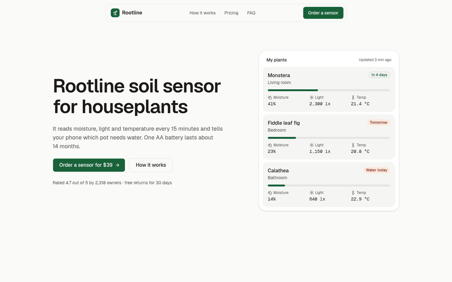
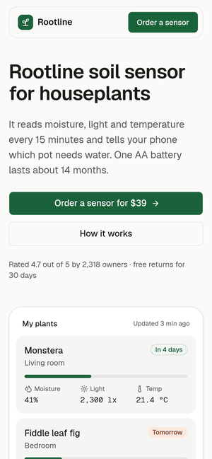
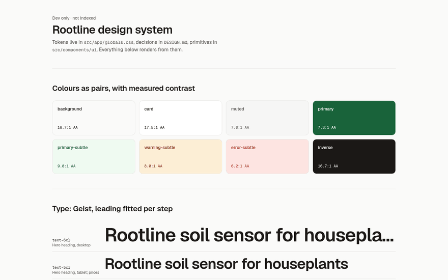
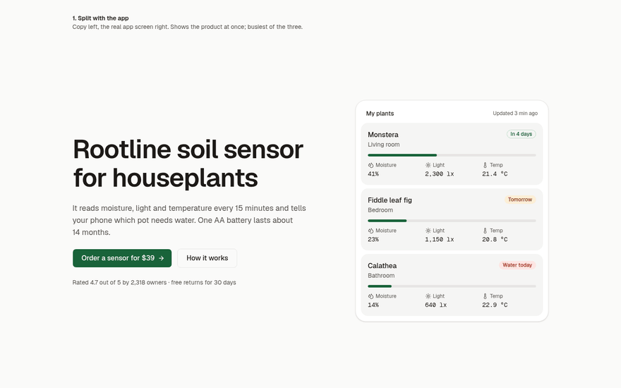

# Landing skills

Six skills for Claude Code that build landing pages on Next.js, shadcn/ui (Radix), Tailwind v4 and Geist. They make the agent work in a fixed order:

1. design system
2. playground
3. two or three variants of each section
4. the page
5. screenshots, then fixes until the checks pass

Everything below was made by running these skills on a fictional product, a soil sensor called Rootline. The code is in [`examples/demo-landing`](examples/demo-landing).

## What you get

### The page

Header, hero, benefits, setup steps, reviews, pricing, FAQ and a closing call to action. The copy names the product and states facts. Sections fade in once as you scroll, and stay still if the visitor turns motion off.

<p>
  
  
</p>

### The design system

Colour tokens in one CSS file, light and dark, plus a `DESIGN.md` that says what each token is for. The playground page draws every token and component from the real classes. Each colour pair shows its measured contrast, and each button state can be checked without hovering.



### Section variants

For each section the agent builds two or three different layouts on one page and asks you to pick. These are the three hero options it made for Rootline:



### The checks

The agent renders the page, takes screenshots at 375, 768, 1023 and 1440 px, then runs the design linter and axe. Here is the output from the demo after the fixes:

```text
design-lint: clean
axe (WCAG 2.1 AA + best practice)   /  375px  no violations
                                    /  1440px no violations
                                    /playground 375px, 1440px  no violations
horizontal overflow                 0px at 375, 768, 1023, 1440
keyboard                            skip link → logo → nav → CTA, focus ring visible on each
```

The first pass found three layout problems: the dark band with the final call to action stuck out past the content edges, the second hero button wrapped badly on phones, and the gap under the hero was too tall. It also found one linter issue (an arbitrary z-index) and a missing `<main>` landmark on the playground. All of them were fixed and checked again before the GIFs were recorded.

## The skills

| Skill | What it does |
|---|---|
| `landing-page-design` | The one to start with. Asks about the offer, writes copy from facts, sets the section order, and runs the workflow and the checks. Has a fallback visual system for projects without a `DESIGN.md`, and an optional section on 3D and scroll scenes. |
| `design-system` | Sets up or audits the tokens (Tailwind v4, one CSS file) and `DESIGN.md`. Includes an audit script. |
| `design-playground` | Builds `/playground`, the live reference, and the variant pages under `/playground/<section>`. Cleans them up after you choose. |
| `design-audit` | Looks at the rendered page: screenshots, sizes, spacing, contrast measured on real pixels. Then runs the linter and the rules. |
| `design-a11y` | Runs axe, walks the page with the keyboard, and checks states and reduced motion. |
| `design-mobile` | Checks the phone version: tap targets, thumb reach, keyboard and inputs, zoom, sticky elements. |

## Install

You need Node.js. The commands use the [skills CLI](https://skills.sh).

All six:

```bash
npx skills add ob192/landing-skills -a claude-code
```

One at a time:

```bash
npx skills add ob192/landing-skills --skill landing-page-design -a claude-code
```

```bash
npx skills add ob192/landing-skills --skill design-system -a claude-code
```

```bash
npx skills add ob192/landing-skills --skill design-playground -a claude-code
```

```bash
npx skills add ob192/landing-skills --skill design-audit -a claude-code
```

```bash
npx skills add ob192/landing-skills --skill design-a11y -a claude-code
```

```bash
npx skills add ob192/landing-skills --skill design-mobile -a claude-code
```

`landing-page-design` works without the others. The other five expect each other: `design-audit` reads the criteria in `design-mobile`, and the playground and audit skills hand token questions to `design-system`. If you take one of the five, take all five.

Add `-g` to install for your user instead of the current project, or drop `-a claude-code` to choose agents from a list. Without the CLI, copy a folder from `skills/` into `.claude/skills/` in your project.

### Rules and linter

`design-audit` and `design-system` also read rules from `.claude/rules/design/` and run a linter from `.claude/scripts/`. Copy them into your project:

```bash
git clone https://github.com/ob192/landing-skills /tmp/landing-skills
cp -rn /tmp/landing-skills/template/.claude/. .claude/
```

This also adds a hook in `.claude/settings.json` that lints every `.tsx` or `.jsx` file Claude edits. If you already have a `settings.json`, the copy skips it, so add the hook by hand. The linter allows one icon library, `lucide-react` by default; change `ICON_SET` in `design-lint.mjs` if you use another.

### 3D and scroll animation (optional)

The 3D section of `landing-page-design` relies on two outside skill sets, which this repo doesn't include:

```bash
npx skills add CloudAI-X/threejs-skills -a claude-code
```

```bash
npx skills add greensock/gsap-skills -a claude-code
```

## Use

Ask for what you want, for example "design a landing page for my product". To get the full workflow, start from [prompts/new-landing.md](prompts/new-landing.md).

To run the demo yourself, see [examples/demo-landing](examples/demo-landing).

## Check the skill files

```bash
pip install pyyaml
python -m unittest discover tests
python scripts/validate_skills.py skills
```

## Credits

`landing-page-design` started from [elayadesign/ai-design-skills](https://github.com/elayadesign/ai-design-skills) (MIT), which borrows from [Leonxlnx/taste-skill](https://github.com/Leonxlnx/taste-skill) (MIT). The skill validator and its tests come from elayadesign/ai-design-skills.

## License

MIT
